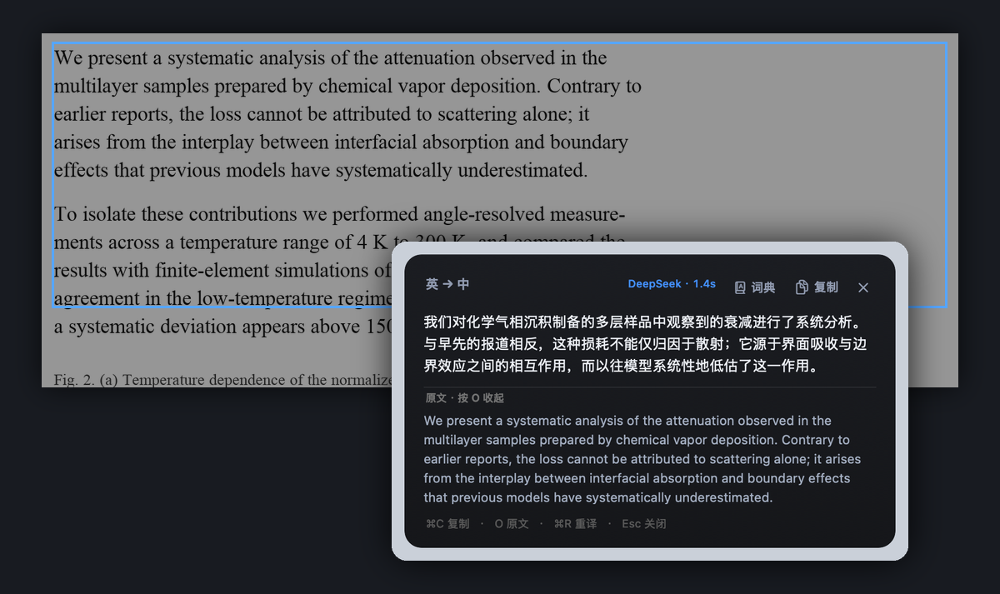
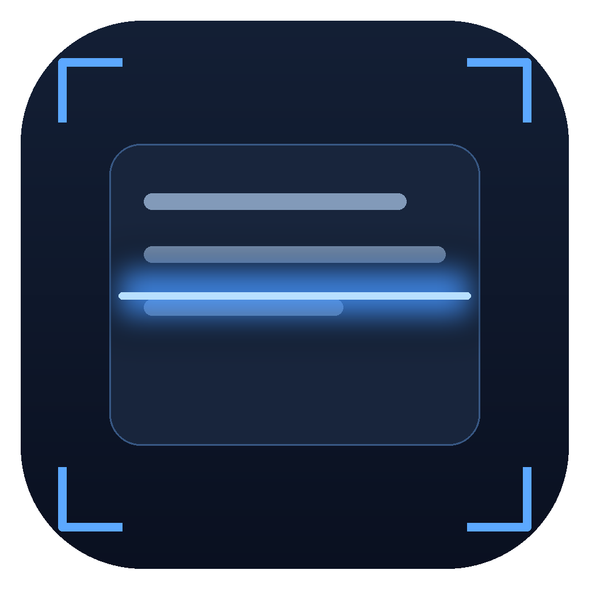

# 扫描卡 · ScanCard

**在任意应用里框一块英文，松手即出中文译文。**

macOS 原生菜单栏小工具：全局快捷键 → 拖框 → Vision OCR → 大模型翻译 → 卡片贴在选区旁边。
无 Electron、无 Python 运行时，单个原生二进制，约 500 KB。



<p align="center">
  
</p>

`macOS 15+` · `Swift / AppKit` · `MIT License`

---

## 它解决什么问题

读英文文献时的典型动作是：截图 / 选中 → 复制 → 切到翻译软件 → 粘贴 → 再切回来。一页文献要重复十几次。

扫描卡把它压缩成一次框选，并针对**学术长句**做了三件通用工具通常不做的事：

1. **按物理像素截图**，不做二次压缩，OCR 置信度显著更高
2. **版面重建**：自动分双栏、剔除页码行号、修复跨行连字符（`measure-` + `ments` → `measurements`）、按行距自适应断段、识别小标题
3. **术语表强约束**：`interfacial absorption = 界面吸收` 这类条目会写进系统提示词，全篇译法统一

## 功能

- 全局快捷键 `⌥⌘S`，在 PDF、Word、浏览器、幻灯片里都能用
- 框选时全屏变暗，带**放大镜**和**像素尺寸徽标**，A/B 对比时不用猜
- 结果卡片带扫描光带动画，贴在选区旁，自动避开屏幕边缘
- `⌘C` 复制译文 · `O` 切换原文 · `⌘R` 重译 · `⌘E` 送欧路词典 · `Esc` 关闭
- 长文自动按段落切块并发翻译，速度与质量兼顾
- 引擎可换：任意 OpenAI 兼容接口（DeepSeek 默认），断网时回退系统本地翻译
- 首选项：模型、接口地址、翻译风格、识别语言、术语表

## 安装

需要 macOS 15+ 与 Xcode Command Line Tools（`xcode-select --install`）。

```bash
git clone https://github.com/ethanliu0612/oujingjing-scancard.git
cd oujingjing-scancard
./build.sh                 # 编译并组装 扫描卡.app
open "build/扫描卡.app"     # 首次启动
```

想常驻使用，把 `build/扫描卡.app` 拖进「应用程序」。

> 发布版请自行签名（`codesign --deep --sign "Developer ID Application: ..."`）。
> **ad-hoc 签名下每次重新签名都会让系统授权失效**，这是 TCC 的机制，不是 bug。

## 首次配置（只做一次）

1. **屏幕录制权限**
   按 `⌥⌘S` → 系统弹出授权框 → 点「打开系统设置」→ 打开「扫描卡」开关。
   macOS 要求**重启进程**权限才生效，应用检测到授权后会自己重启，无需手动。

2. **API Key**
   菜单栏取景器图标 →「设置…」→ 填入 DeepSeek Key →「测试连接」。
   Key 存进系统钥匙串；钥匙串不可用时回退到 `~/Library/Application Support/ScanCard/credential`（权限 600）。

> 想用别的模型：设置里把接口地址改成任意 OpenAI 兼容端点（如 `https://api.openai.com/v1`），模型名填对应的即可。

## 使用

| 操作 | 说明 |
| --- | --- |
| `⌥⌘S` | 全局框选翻译 |
| 拖拽 | 框住区域，松手立即开始 |
| `Esc` / 右键 | 取消框选 |
| `⌘C` | 复制译文 |
| `O` / `空格` | 展开、收起原文 |
| `⌘R` | 用同一段原文重译 |
| `⌘E` | 选中的词送欧路词典 |
| `Esc` | 关闭卡片 |

**准确度小贴士**

- 只框正文一栏，避开页眉、图注、脚注，段落会更整齐
- 屏幕缩放比例高反而更准，因为拿到的是物理像素
- 专业名词写进「术语表」，一行一条：`chemical vapor deposition = 化学气相沉积`

## 架构

```
Sources/
  main.swift            入口 + 命令行自测（--ocr / --translate / --pipeline / --capture / --render-card / --diag）
  AppDelegate.swift     菜单栏与菜单
  HotKey.swift          Carbon 全局快捷键（无需辅助功能权限）
  Selection.swift       多屏框选遮罩、放大镜、尺寸徽标
  Capture.swift         ScreenCaptureKit 整屏预抓 + 精确裁切
  OCR.swift             Vision 识别 + 版面重建
  Translate.swift       DeepSeek 翻译、分段并发、兜底调度
  AppleTranslate.swift  系统 Translation 框架桥接（离线兜底）
  CardView.swift        结果卡片视图（自绘渐变、扫描动画）
  CardController.swift  卡片窗口与流水线
  Settings.swift        设置面板
  Permissions.swift     权限引导与自动重启
```

流水线：`全局热键 → 整屏预抓（含放大镜数据）→ 遮罩拖选 → 按显示器物理像素裁切 → Vision OCR → 版面重建 → 分段翻译 → 卡片呈现`

### 命令行自测

```bash
./build/ScanCard --pipeline 图片.png      # OCR + 翻译整条链路
./build/ScanCard --ocr 图片.png           # 只看识别结果与置信度
./build/ScanCard --diag                   # 权限 / 密钥 / 多实例状态
./build/ScanCard --render-card /tmp/c.png # 离屏渲染结果卡片，调 UI 用
```

## 已知限制

- 只支持 macOS 15+（用到 ScreenCaptureKit 与 Translation 框架）
- 框选限定在单个显示器内（跨屏选区会按起始屏裁切）
- 需要自备 API Key；翻译质量与成本取决于所选模型
- ad-hoc 签名分发：用户升级新版本后需要重新授权屏幕录制
- 本地翻译兜底需要先在系统里下载英→中语言包

## Roadmap

- [ ] 连续按两次 `⌥` 直接翻译当前选中文本（比框选更省事）
- [ ] 结果卡片支持「中英对照」排版与导出 Markdown
- [ ] 截图后自动判断是否双栏，跨栏选区按阅读顺序拼接
- [ ] 生词本：把术语表里的词条同步到欧路

## 安全

- 仓库内**不含任何 API Key**；`.gitignore` 已屏蔽 `credential`、`.env`
- Key 只存本机（钥匙串 / 600 权限文件），不上传任何第三方
- 截图仅在内存中处理，不落盘、不上传；只有识别出的文本会发给你配置的翻译接口

## English

**ScanCard** is a tiny macOS menu-bar app that translates any screen region into Chinese in one drag.
Press `⌥⌘S`, drag a box over English text, and a floating card shows the translation within a couple of seconds.

- Native Swift/AppKit (no Electron), ~500 KB binary
- ScreenCaptureKit capture at native pixel resolution + Apple Vision OCR
- Layout reconstruction: two-column detection, hyphenation repair, page-number filtering
- LLM translation (DeepSeek by default, any OpenAI-compatible endpoint) with a user glossary
- Offline fallback via the system Translation framework

```bash
./build.sh && open "build/扫描卡.app"
```

Requires macOS 15+, Xcode Command Line Tools, and your own API key.

## License

[MIT](LICENSE)
